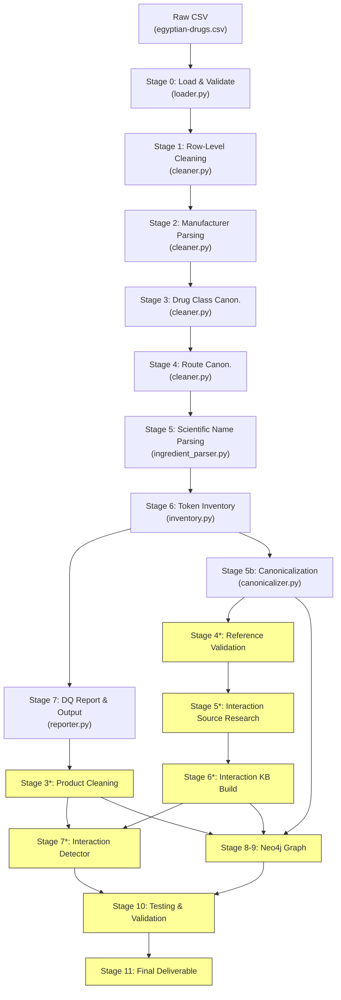
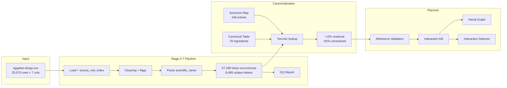

# Pipeline Architecture — Egyptian Drug Knowledge Graph

> Generated: 2026-10-24

## Overview



> [!NOTE]
> Yellow nodes are NOT YET IMPLEMENTED. Stages marked with `*` use the user-request numbering, not the internal pipeline numbering.

## Execution Modes

### Mode 1: Full Pipeline (existing)
```bash
python run_pipeline.py --source data/egyptian-drugs.csv --output outputs/ --config config/
```
Runs Stages 0–7 (internal numbering), producing all outputs in `outputs/`.

### Mode 2: Canonicalization (standalone)
```python
from src.drug_pipeline.canonicalizer import run
run(
    token_table_path="outputs/ingredient_token_table.csv",
    synonym_map_path="config/ingredient_synonym_map.csv",
    canonical_table_path="config/canonical_ingredients.csv",
    output_dir="config/"
)
```

### Mode 3: Planned Stages (not yet implemented)
- Reference validation → `src/drug_pipeline/reference_validator.py`
- Interaction source retrieval → `src/drug_pipeline/interaction_sources.py`
- Interaction KB → `src/drug_pipeline/interaction_builder.py`
- Product cleaning → `src/drug_pipeline/product_cleaner.py`
- Interaction detector → `src/interaction_detector.py`
- Neo4j export → `src/drug_pipeline/neo4j_exporter.py`

## Data Flow



## Technology Stack

- **Language**: Python 3.14+
- **Data Processing**: pandas
- **Graph Database**: Neo4j (planned)
- **Testing**: pytest
- **Dependencies**: pandas, colorama, pytest, coverage (from `requirements.txt`)

## Key Design Principles

1. **Immutability**: Source data is never modified. All transformations add new columns
2. **Traceability**: Every record has a `source_row_index` linking back to the raw CSV
3. **Conservative resolution**: Ambiguous cases are flagged, not automatically resolved
4. **Two-tier canonicalization**: Exact match first, normalized fallback only when unambiguous
5. **Configuration-driven**: Mapping files (CSV) drive canonicalization — no hardcoded rules
6. **Idempotent**: Re-running on the same inputs produces the same outputs

